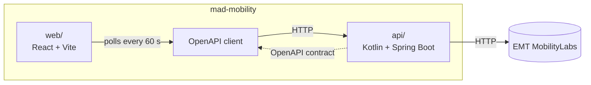

# Mad Mobility

[](https://github.com/jorgetroya80/mad-mobility/actions/workflows/ci.yml)
[](https://github.com/jorgetroya80/mad-mobility/releases)
[](https://github.com/jorgetroya80/mad-mobility/releases)
[](LICENSE)

Madrid mobility data, starting with BiciMAD, built on the EMT Madrid MobilityLabs API.

**Live:** [mad-mobility-web.onrender.com](https://mad-mobility-web.onrender.com) (free hosting: after 15 minutes without visits the API sleeps, and the first visit takes up to 3 minutes).

## Overview

What works today:

- **BiciMAD stations API**: list all stations and look one up by its number (`/v1/bicimad/stations`, `/v1/bicimad/stations/{number}`).
- **Typed client**: every API release publishes `@jorgetroya80/bicimad-client` to GitHub Packages, generated from the OpenAPI contract.
- **Web map**: nearby BiciMAD stations with live bikes and free docks, station search and favorites.

Coming next: EMT buses.

## Tech stack

**Backend** ([`api/`](api/README.md))

- Kotlin 2.3 on Java 25, Spring Boot 4.1 (Web MVC, virtual threads)
- Spring Modulith for module boundaries
- Caffeine cache and Resilience4j for calls to the EMT
- springdoc for the OpenAPI contract, Gradle 9 for the build
- JUnit, MockK, WireMock and Testcontainers for tests

**Frontend** ([`web/`](web/README.md))

- React, Vite and TypeScript on Node 24, with pnpm
- MapLibre for the map, Tailwind for styling
- TanStack Query for data fetching
- `@jorgetroya80/bicimad-client` (generated with hey-api) for typed API calls

## Architecture

The repo is a monorepo with two apps. The API defines its OpenAPI contract in code (served at `/v3/api-docs` in local dev only); the web never hand-writes API types and talks to the API only through the client generated from that contract.



| Path                        | Contents                                                    |
| --------------------------- | ----------------------------------------------------------- |
| [`api/`](api/README.md)     | Spring Boot API that wraps MobilityLabs                     |
| [`api/client/`](api/client) | TypeScript client generated from the API's OpenAPI contract |
| [`web/`](web/README.md)     | React frontend                                              |

See each app's README for its internal architecture.

## Running locally

You need JDK 25 and EMT MobilityLabs credentials for the API, and Node 24 plus a GitHub token with `read:packages` for the web app (see [web/README.md](web/README.md)).

1. Copy the env template and fill in your credentials (`EMT_EMAIL` and `EMT_PASSWORD`, or a registered app's `EMT_CLIENT_ID` and `EMT_PASS_KEY`):

   ```bash
   cp api/.env.example api/.env.local
   ```

2. Start the API on `localhost:8080`:

   ```bash
   cd api && ./gradlew bootRun
   ```

3. Try it:

   ```bash
   curl 'localhost:8080/v1/bicimad/stations?near=40.4168,-3.7038&radius=500&need=docks'
   curl localhost:8080/v1/bicimad/stations/538
   ```

4. Start the web app on `localhost:5173` (it proxies `/api` to the API):

   ```bash
   pnpm install
   pnpm --filter web dev
   ```

   Without the API, `pnpm --filter web dev:mock` serves fake data from the browser.

Swagger UI is at `localhost:8080/swagger-ui.html` while `bootRun` is running. Run the tests with `./gradlew test` (no credentials needed).

## Deployment

Both apps run on [Render](https://render.com)'s free plan, described in [`render.yaml`](render.yaml) (a Render Blueprint). Render never builds anything: it runs what each release already published.

- **API** (`mad-mobility-api`): a web service that runs the Docker image `ghcr.io/jorgetroya80/mad-mobility-api`. On an `api` release, the `deploy-api` job calls the service's deploy hook with that release's image tag.
- **Web** (`mad-mobility-web`): a static site. Its build ([`scripts/render-web-build.sh`](scripts/render-web-build.sh)) downloads the `web-dist.tar.gz` of the current `web` release. On a `web` release, the `deploy-web` job calls its deploy hook.
- **Direct calls**: the web's production build ([`web/.env.production`](web/.env.production)) calls the API, which allows the web's origin through CORS (`CORS_ALLOWED_ORIGINS` in `render.yaml`). The API rate-limits each client by the `True-Client-Ip` header that Cloudflare, in front of Render, sets to the real IP. A static-site rewrite of `/api/*` was tried first and dropped: its second hop through Cloudflare made every user look like Render's IP.

The `deploy-*` jobs in `release.yml` only run when the repository variable `DEPLOY_ENABLED` is `true`. They need the secrets `RENDER_DEPLOY_HOOK_API` and `RENDER_DEPLOY_HOOK_WEB`. The EMT credentials (`EMT_CLIENT_ID` and `EMT_PASS_KEY`) live only in Render.

To recreate it: in Render, **New > Blueprint** on this repo (branch `main`), fill in the EMT credentials, then copy each service's deploy hook into the GitHub secrets above. The Blueprint must track `main`: if its branch is deleted, syncs fail with "not found: render.yaml". A sync does not delete redirect/rewrite rules or env vars removed from `render.yaml`; remove those in the dashboard too. Details in [SPEC-deploy.md](docs/specs/SPEC-deploy.md).

## License

Code released under the [MIT License](LICENSE).

Data powered by [EMT de Madrid](https://www.emtmadrid.es) through [MobilityLabs](https://mobilitylabs.emtmadrid.es/), under its [terms of use](https://mobilitylabs.emtmadrid.es/sip/terms-of-use).
